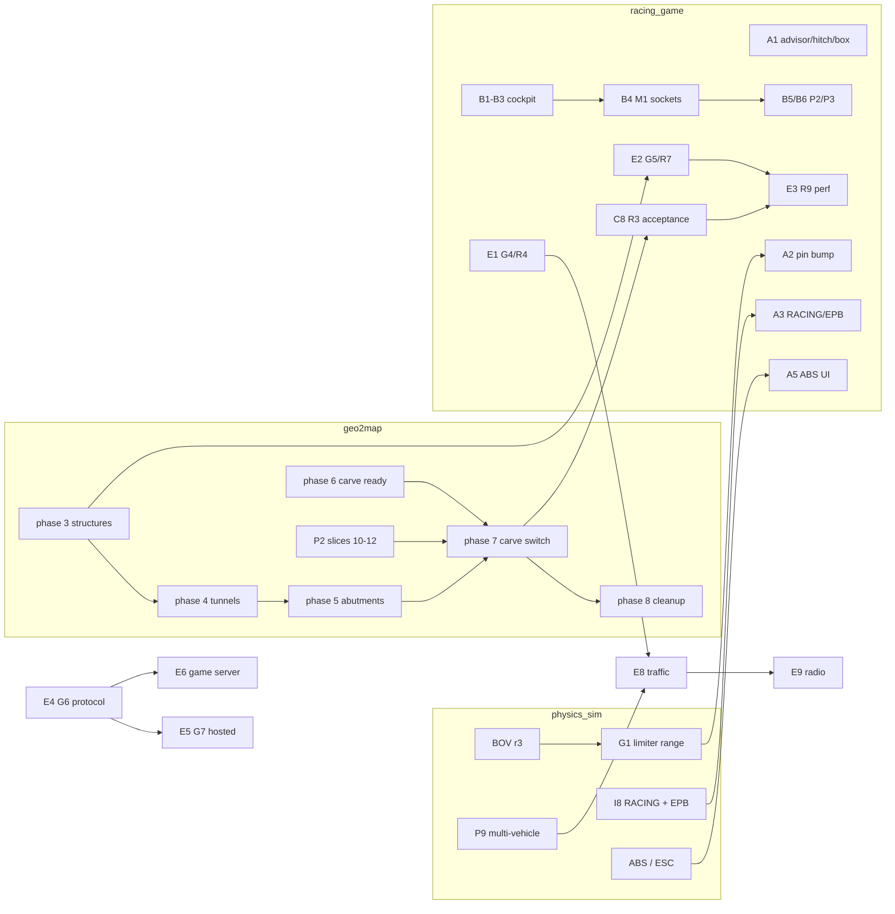

# racing_game: brief for all remaining work (hand-off, 2026-10-14)

Written by the racing_game coordinator session for whoever continues, including a
session on a different Claude account. This file stands on its own. The physics
side has its own matching brief: physics_sim `out/next_steps_brief.md` (written by
the physics session; see "Physics dependencies" below for what we need from it).

State at writing: racing_game main `6f959e1` (pushed), pins physics_sim `1e07c0e`
(pedal P1), geo2map_engine `7d69577`. Playable snapshot
`S:\claude_code\racing_game_releases\20261014-1443_6f959e1` (`latest.cmd`).

## 0. Read first, in this order

1. `CLAUDE.md` (architecture map) and `PLAN.md` section 12 (milestones and their
   acceptance tests).
2. `out/racing_game_context.md` (coordinator's verified anchors; gitignored, only on
   the original machine) and `out/racing_game_queue.md` (dated work log, newest at
   the bottom; gitignored too). If you are on another machine, this brief replaces
   both. Ask the owner for copies if you need the anchors.
3. Topic docs named in each work package below (`docs/*.md`, geo2map
   `docs/terrain_migration_plan.md`, geo2map `docs/pipeline/README.md`).
4. The knowledge vault `S:\claude_knowledge_base`. Search it before each task:
   `S:\claude_knowledge_base\knowledge-manager\gradlew.bat -p S:\claude_knowledge_base\knowledge-manager run --quiet --args="search 'terms' 3"`.
   Relevant series: RACE-*, PHYS-*, G2M-*, TOOL-*.

## 1. Rules that apply to every package

### Ownership and concurrency
- **One agent and one CI owner per repository at a time.** The three repos are
  racing_game, physics_sim and geo2map_engine. Parallel work therefore means
  parallel REPOSITORIES, not parallel agents in one repo. Before starting, check the
  build lock (`out\build.lock\owner.txt` in each repo) and the queue file. Write a
  dated line into the queue when you take or finish a package.
- **Accounts:** if two Claude accounts work at once, split by repository, not by
  task. Example: account A takes racing_game, account B takes geo2map_engine, and
  the physics session keeps physics_sim. Hand a repo over only at a pushed commit.
- **Read-only from racing_game:** `external/physics_sim/**` and
  `external/geo2map_engine/**` (only the submodule pointers move).
- **Read-only, owned by other sessions:** physics_sim `data/models/**`,
  `data/tracks/test_ground/**`, `tools/assetgen/**`, and the home-r1 store.
- **Vault:** write only through the gradlew CLI (`save-file` / `update-file`), one
  writer at a time, never by hand. The knowledge MCP server currently fails with
  CONNECT_TIMEOUT; use the CLI. Next free IDs (check with Glob first): RACE-021,
  PHYS-077, G2M-021, TOOL-048.

### Building, testing and committing
- **Windows builds:** PowerShell only, after
  `. .\tools\common.ps1; Enter-VsDevShell`. Never run `cmake --preset` from Git Bash.
- **Submodule pointer:** `git add external/` BEFORE CI. `tools\ci.ps1` resets
  submodules to the recorded pins, so an unstaged pointer means you test the old pin.
- **CI per change:** `tools\ci.ps1 -Only release -SkipSmoke`, plus the headless
  garage check when the garage or setup changed:
  `$exe=Find-GodotConsoleExe; & $exe --headless --path game --quit-after 200000 -- --garage-test --shell-user-dir <fresh dir>`.
  Owner: "Don't run tests unless reaaaaally necessary". Run the scoped checks, not
  everything.
- **Godot:** the owner may be running Godot. Owner rule, verbatim: "before anything
  is declared prod (which it is expressly not right now), you may close any Godot
  session I am, the user and owner, am running." Always say when you closed one.
  Never kill unknown processes from other sessions.
- **Commits:** end with your model's own Co-Authored-By trailer. Agents never push;
  the coordinator pushes (GitHub `SebastianDanielFrenz/racing_game`, `main`). Leave
  `game/scripts/traction_control_test.gd.uid` untracked.
- **Snapshots:** after a verified push, refresh the playable snapshot with
  `tools\make_release.ps1 -SkipBuild` (keeps 3).

### Design and process
- **Engine-neutral logic:** logic goes in `core/` (rg_core); `godot_ext/` and
  `game/scripts/` stay thin. A UE5 port may happen.
- **Limits are config:** refusal limits, advice thresholds and similar numbers live
  in data files, never in code.
- **Installs:** only through setup scripts, and only with owner approval. Map and
  geodata downloads are free. Accounts, tokens and purchases need asking.
- **Model tiers:**
  - Haiku 5.5, effort medium: mechanical work with named files and exact checks.
  - Sonnet 5.5: implementation from a precise brief.
  - Opus 5.5: design, numerics, root-causing, determinism, concurrency.
  - The coordinator diagnoses, briefs, verifies diffs and pushes. Never accept a
    `[!mayfail]` or "physical" explanation without a measurement that tells the
    hypotheses apart.
- **Owner style:** metric units, plain spoken-style reports, no wasted tokens, and
  "Don't overthink it".
- **Usage:** the original account stops at 94 % of the weekly cap (resets
  2026-10-18 11:00 UTC). It stops starting new agents at 88 % and pauses them at
  92 %.

## 2. Work packages

ID, goal, anchors, prerequisites, tier, size (S/M/L). "[phys X]" = needs physics
package X pushed and the pin bumped first. "[g2m X]" = the same for geo2map.

### Lane A: physics follow-ups on the game side (racing_game)

- **A1 Advisor stage-map flag + hitch + box-ground checks.** Sonnet, M. Ready now.
  - (a) Surface `BuildRule::TurboStageMapCoverage` (17) and the loader warning
    (`EngineMapOptions::warnings_out`) in the garage setup check. The game's
    `hyper_twin_standard_n2o` stage map is Near at 1.8 bar (68.8 % of flows
    covered). Optional: a HUD hint from
    `EngineSoundState::turbo_compressor_stage_extended`. Use the owner's format:
    a bold title, then short factual lines with numbers.
  - (b) Measure the 0.61 s full-load envelope build (physics P1). It runs on the
    caller thread at load and on every turbo swap. Find which thread pays for it
    at spawn, garage apply and live turbo swap. If it is the main or sim thread,
    move it to a worker or the loading screen.
  - (c) Check that no game world or test uses a large static box ground (physics
    D0: phantom wheel casts on huge thin boxes). Heightfield and mesh grounds are
    fine.
- **A2 Next physics pin bump.** Haiku, S. [phys BOV round 3, phys G1 limiter range; later P1b, Q5, the A25A VE fix and each re-pin the same way]
  - Rerun `test_rev_limit_extremes`, drop its workarounds, and rerun the advisor
    `[long]` test. The BOV moves car_hyper/_n2o numbers, so update expectations.
- **A3 RACING mode + EPB wiring.** Sonnet, M. [phys I8: RACING drive mode for
  car_hyper/_n2o, EPB law per mode]
  - The game already reserves the `epb` channel and the cluster lamp
    (`DriverActions`, C1).
  - Add the mode to the drive-mode selector (only modes in
    `drive_modes_available_bits`) and give it a theme colour.
- **A4 Sedan assist unit.** Haiku, S. Ready now.
  - Offer physics `data/electronics/assist_unit_street.json` (or sport) as a garage
    part on the sedans. The pattern is commit 8cc0e19.
- **A5 ABS in the garage and HUD.** Sonnet, S. [phys ABS: not built yet; planned as
  physics I5 next to TC]
- **A6 Clutch bite per drive mode.** S. [phys follow-up on request]
  - Physics found the per-mode close time nearly inert. The real levers are
    `engage_rate_per_s` / `max_sync_torque_nm`.
  - Owner decision needed: is it worth it?
- **A7 N2O gain measurement.** Sonnet, S. Ready now. Postponed, not dropped (owner).
  - car_hyper_n2o in 3rd, car_sedan_gen_n2o in 2nd: WOT armed vs not armed.
  - Report dv, time to 6000 rpm and boost.
- **A8 Brake-bias limits to data.** Haiku, S. Ready now.
  - Move them out of `core/src/vehicle_setup.cpp` into `data/vehicles/setup_options.json`.

### Lane B: cockpit, controls and VR (racing_game; spec `docs/cockpit_remaining_work_brief.md`)

- **B1 Cockpit switches -> RgDriverActions.** Sonnet, S. Ready now.
  - The hazard/indicator/horn/light switches in `cockpit_controls.gd` are cosmetic
    today. Submit `ActionEvent`s instead, keeping one owner of cabin state.
- **B2 Unify the steering-wheel lock.** Haiku, S. Ready now.
  - Today cargen `cockpit.json` uses `lock_to_lock_turns` and `data/controls/cabin.json`
    uses `steering_wheel_lock_deg`. Pick one schema and convert the other.
- **B3 Cursor default for clickable cockpits.** Owner question first, then Haiku, S.
  - Should a car with a clickable cockpit start with the cursor free?
- **B4 M1 permanent cockpit furniture and sockets** (hypercar: centre vents with the
  hazard between them, tunnel rows L1-5/R1-5, lever socket, start/stop).
  - The car model owner must agree. The `.glb` files live in physics_sim
    `data/models` (read-only for us).
  - Then B5 (P2 variants / fitted-state controls), B6 (P3 click interaction), and
    later VR hands.
- **B7 Gamepad bindings, Dashboard v2, VR menu check.** Sonnet, M each. Independent
  of B1-B6.

### Lane C: terrain migration and roads (geo2map_engine first, then racing_game)

Spec: geo2map `docs/terrain_migration_plan.md`. Phases 0-2 are done. Every phase is
one geo2map commit with tests, then one racing_game commit that bumps the pin,
switches callers, deletes the game copy and test-drives the corridor. Use the
roadcmp probe (`out/roadcmp`, `RG_ROADCMP=1`): zero game-only differences before
any game profile code is deleted.

- **C1 Phase 3:** structure meshes (`deck()`, `road_deck_height`,
  `build_road_decks`, roof inference), ribbons and streamers into geo2map. M+M,
  Sonnet from the plan.
- **C2 Phase 4:** completion parity, tunnels + bridge anchors. Release-id bump #1.
  Opus, M.
  - Owner: curved and sloped tunnels must work, and the straight-fit threshold
    stays configurable.
- **C3 Phase 5:** abutment walk length + margin. Release-id bump #2. M.
- **C4 Phase 6:** served carve readiness. geo2map only. M.
- **C5 Phase 7:** carve switch. Release-id bump #3. Opus, L.
  - The game deletes its own carve step with no fallback.
- **C6 Phase 8:** remove the facade remnant. S.
- **Parallelism and order:**
  - Phases 3, 4 and 6 are independent of each other; phase 3 can run beside 4.
  - Phase 5 follows 4; phase 7 needs 4, 5 and 6; phase 8 is last.
  - In practice there is one geo2map agent, so the order is 3 -> 4 -> 5 -> 6 -> 7
    -> 8, each followed by its racing_game bump.
- **Warm the stores** (`warm()` or the bake tooling) after each release-id bump,
  before an owner test drive.
- **C7 geo2map P2 slices 10-12** (`terrain.class`, wiring, census incl. G-6
  underpass dips) and G3-C profile acceptance. Spec: geo2map
  `docs/street_fidelity/p2_junction_design.md`. Opus/Sonnet. Fold into C4/C5 where
  they touch the carve.
- **C8 R3 completion:** markings (P3), bridge bodies driveable both ways, and the
  20-junction route acceptance (G3-F/R3).
  - Spec: `docs/g3_consumer_design.md` slices S4-S14; route
    `data/routes/home_g3_junctions.gen.json`, follower and checker in
    `core/src/route_follower.cpp` / `route_check.cpp`.
  - After C5 (it needs served carve and decks).
- **C9 Render streaming leftovers:** far road layer (3c, needs a geo2map product),
  diff pipelining + worker-side Packed arrays, ribbon re-sort, Forward+/Mobile A/B
  only with evidence. Sonnet, M. After C1.
- **C10 Fast first load after a release-id change.** Sonnet, M. Best after C2/C3,
  which bump the id.
  - Today the gate re-derives roads.geom in about 13 s in release; the debug DLL
    times out.

### Lane D: garage and engines

- **D1 Wider stage map for the n2o hyper** (tools/turbo_sim in physics_sim
  regenerates it), or accept the S0 continuation. Owner choice. Belongs to the
  physics session.
- **D2 Engine design GUI.** Opus design, then Sonnet. Edits engine JSON only; a web
  page is fine. Prereq: physics generator (done).
- **D3 Demon 170 supercharged V8.** [phys supercharger model (not planned yet), V8
  generator (done), knock limit (done P7)]

### Lane E: milestones still ahead (PLAN.md section 12)

| ID | Scope | Prerequisites | Tier |
|---|---|---|---|
| E1 G4/R4 | routing (A* + hierarchy, restrictions), minimap, full map, guidance | G3 roads.graph (done) | Opus design, Sonnet impl. |
| E2 G5/R7 | land cover, buildings, water, vegetation, building collision | C1 (structures in geo2map) | Sonnet; Opus for collision streaming |
| E3 R9 | performance: 4K/240 with FSR, < 1 ms main-thread adapter work, no stream hitch at 100 m/s | after C-lane and E2 (measure the final pipeline) | Opus analysis, Sonnet fixes |
| E4 G6 | wire protocol + sidecar server | none (independent of the C-lane) | Opus spec, Sonnet impl. |
| E5 G7 | hosted default server | E4; owner decisions D3/D4/D7/D15 | Opus ops design |
| E6 game server | multiplayer sync of players, weather and traffic; `docs/game_server.md` (plan only) | E4; physics weather W-series for sync | Opus |
| E7 G8/R10 | worldwide (GLO-30, zone crossing, other states' DGM1) | E4 | Opus |
| E8 traffic | lane graph, signals, AI on physics vehicles (NPC traffic exists in `npc_traffic.h`) | E1; physics multi-vehicle budgets P9 | Opus |
| E9 radio | mood-following radio | E8 (owner: not before traffic) | Opus + Sonnet |

Also owner-requested, low priority: stacked interchanges (deferred), player modes VR
polish (after main features).

## 3. Physics dependencies (what the game waits for)

Authoritative list: physics_sim `docs/next_steps_brief.md` (physics master
`1858978`; `docs/handoff/` holds its coordinator log, agent briefs and CI wrapper
scripts). Physics order after the 2026-10-18 reset: BOV r3 -> G1 -> I8 -> P1b ->
Q5. A9 SIMD, ARM64, one of {R0, W7} and P10 data run in parallel.

| Physics package | Game package it unblocks | Status 2026-10-14 |
|---|---|---|
| BOV round 3: data only (blow_off_valve in hyper_twin_default/_n2o, 1330 mm² per turbo, crack 1.1 / full 1.6 bar, tau 20 ms) | A2: in-shift charge peak 2.63-2.90 bar, boost recovery after an upshift 0.34-0.83 s, rotor 39k rpm at +0.5 s after a lift. Re-pin any game test on hyper boost, rotor speed or shift traces. WOT torque is unchanged. | **DONE**, physics master 8970138 (no scenario hash or audio bank pin moved) |
| G1 limiter range: LC clamp, shift points follow the limiter, roll-off past data, A25A plateau | A2 | after BOV |
| I8 RACING mode + EPB law per mode | A3 | queued |
| P1b closed-plate fired floor (closes the DFCO pedal band) | re-pin; moves the sim-engine scenario hashes | after I8 |
| Q5 turbo full-load envelope rebuild off the caller thread (0.61 s on a hyper miss) | A1(b) garage turbo-swap hitch: may make the game-side fix unnecessary | after P1b |
| ABS / ESC (physics package 2.2b; touches vehicle_instance and the assist unit, so serial with I8, R0 and W7-W10) | A5 | not started |
| R0 barrel rolls | needs a game repro first (car, map, speed, input): capture one to unblock it | still a hypothesis |
| W7 aquaplaning + per-wheel tyre_profile resolution (today only parsed) | wet weather in game, tyre choice per wheel | open |
| W8 snow, ice, frost, black ice; W10 tyre temperature and wear | winter weather, tyre wear in game | open |
| W11 environment sync | E6 game server (weather sync) | open |
| Transmission A1-A4, C1 CVT, D1 hyper DCT, M1/M2 | P/R/N/D/M selector UI and the snapshot selector/converter/CVT fields wait on A3/D1. The 300 km/h 6<->7 hunt is fixed by the shift policy here. | open |
| LimitKind 19 TurboMapCoverage | A1(a) (better than reading the BuildRule warning) | awaits the owner's OK |
| Stage-map turbine-side fallback | D1 | untouched |
| A25A sim-engine VE-axis data fix; optional knock on the A25A cars (owner choice) | re-pin; moves the vehicle_sim_engine/vehicle_gen_engine hashes | open |
| Supercharger model | D3 | later engine feature, unscheduled |
| Multi-vehicle budgets (PLAN.md P9) | E8 traffic | not started |
| Linux ARM64 build (Steam Frame) | Steam Frame native build | toolchain done, Steam Runtime SDK untested |

Every physics change reaches the game through a pin bump (lane A2 pattern): read the
physics merge notes, bump, stage the pointer, CI, fix fallout, update
`CLAUDE.md`'s pin line.

## 4. Dependency graph

## 5. Suggested parallel schedule (one agent per repo)

- **Stream 1, racing_game** (sequential queue):
  A1 -> A4 + A8 (Haiku, one bundle) -> B1 + B2 (+ B3 after the owner answers)
  -> A7 -> each C-lane pin bump as geo2map delivers -> A2 / A3 / A5 when physics
  delivers -> C8 -> E1.
- **Stream 2, geo2map_engine:** C1 (phase 3) -> C2 -> C3 -> C4 + C7 -> C5 -> C6,
  then E4 (G6), which is independent of the game queue.
- **Stream 3, physics_sim** (its own brief): BOV r3 -> G1 -> I8 -> ABS, plus its own
  backlog.
- **File conflicts:** C-lane bumps touch `core/src/world_terrain.cpp`, `session.cpp`
  setup_terrain, the render streamers and road code. Cockpit work touches
  `game/scripts/cockpit_*`, `driver_actions.*` and `main.gd` `_forward_driving`.
  Pin bumps A2/A3 touch `session.cpp` channel names and garage files. Do not run two
  of these in one racing_game working tree; the one-agent rule already prevents it.

## 6. Hand-over checklist when you stop

1. Push, or tell the coordinator to push, the finished commits. Never leave
   verified work only local.
2. Refresh the snapshot after a verified push.
3. Append a dated line to `out/racing_game_queue.md` (or to this file's "Log" below
   on another machine): what is done, what is next, any pin you staged but did not
   commit.
4. Release the build lock. Record vault tickets through the CLI.

## Log
- 2026-10-14: brief written (coordinator, Opus 5.5).
- 2026-10-14: section 3 corrected from the physics brief (physics master 1858978).
- 2026-10-14: physics BOV r3 pushed (8970138). Not bumped yet: racing_game has an open PR (#5) from the other account. A2 bumps once G1 lands, or earlier if the owner asks.
